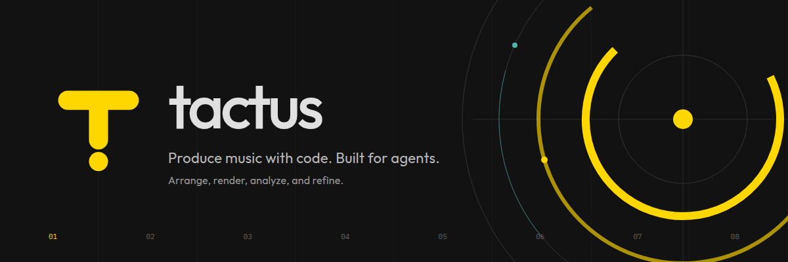

# Tactus



*Arrange, render, analyze, and refine.*

Tactus is a programmable music production runtime for people and agents. It handles
execution and records what produced each result; the author makes the musical decisions.

## Core ideas

- **Code owns the work.** Python source, pinned materials and dependency locks capture
  creative choices; Git records revisions.
- **Compose freely.** Combine builtin synthesis blocks and DSP, existing libraries, VSTs
  and your own functions.
  Choose the timing, routing and arrangement that suit the music.
- **Maintain music as code.** Use functional, modular code with clear interfaces; reveal
  implementation details as needed when reading or revising a work.
- **Listen and iterate.** Render separate candidates, use measurements as observations,
  and preserve the performances you choose.

## Install

### CLI and dependencies

Install [uv](https://docs.astral.sh/uv/getting-started/installation/) and Git first.
Tactus uses Python **3.12**; uv can install it. Git-sourced native dependencies also need
C and C++20 compilers, such as GCC or Clang.

```bash
git clone https://github.com/rytho-ai/tactus.git
cd tactus
uv tool install --python 3.12 --editable .
tactus doctor
```

The editable install follows this checkout;
see [fixed-revision installation](skills/references/project-commands.md#install-and-select-a-work)
for a portable setup.

### Core dependencies

The CLI installation automatically installs these runtime packages:

| Package | Role |
|---|---|
| **NumPy** | Audio arrays, synthesis, mixing and numerical operations |
| **SciPy** | Filters, resampling, FFT and analysis algorithms |
| **SoundFile** | Audio file reading and writing |
| **Numba** | Accelerated numerical kernels for DSP and analysis |
| **Pedalboard** | Audio effects and VST3 hosting |
| **pytimestretch** | Time stretching, pitch shifting and marker-based warping |
| **pyqmdsp** | QM-DSP beat tracking |
| **Mido** | MIDI messages and files |

Each work has its own locked environment. Add further dependencies there with `uv add PACKAGE`;
librosa is optional via `uv add "tactus[librosa]"`. External instruments, VST plugins and
sample libraries are installed separately. See [package notes](skills/references/packages.md)
for integration details; [pyproject.toml](pyproject.toml) and `uv.lock` record dependency constraints and pins.

### Agent skills

The `tactus` plugin provides **compose** (write and revise works), **dsp** (use or build
effects), **measure** (use or write analyses) and **version** (track work revisions
with Git). Install it from this repository root
for your agent host. Run the following commands from a clean checkout root.
For an active development checkout containing local pools or dogfood runs, use the
[tracked snapshot workflow](skills/README.md#install-from-a-development-checkout).

**Codex:**

```bash
codex plugin marketplace add .
codex plugin add tactus@tactus-local
```

**Claude Code:**

```bash
claude plugin marketplace add "$PWD"
claude plugin install tactus@tactus-local
```

Start a new session to load the skills. Platform manifests and marketplace catalogs
are separate entry points; both hosts use the single shared `skills/` directory.
The plugin installation is separate from the Python runtime installation above. See the
[plugin guide](skills/README.md) for skill details and updates.

## Your first audio

From the Tactus checkout, create a separate work:

```bash
tactus init ../my-work --tactus-path "$PWD"
cd ../my-work
```

Use the [version workflow](skills/version/SKILL.md) to commit the work's
source and lock before rendering, then preserve and commit the revisions you choose.
`tactus init` requires Git and creates the work's own repository, including inside another
checkout. Commit source after writing it; initialization alone creates no version history.

Save this as `song.py`:

```python
import numpy as np
from tactus import dsp


def render(*, gain=0.2):
    sample_rate = 48_000
    t = np.arange(2 * sample_rate) / sample_rate
    tone = gain * np.sin(2 * np.pi * 220 * t)
    audio = dsp.fade(tone, sample_rate, in_s=0.01, out_s=0.1)
    return {"sample_rate": sample_rate, "outputs": {"mix": audio}}
```

Render it, then try a quieter candidate:

```bash
tactus run song.py --out runs/a
tactus run song.py --out runs/b --params '{"gain": 0.1}'
```

Each output directory must be new. The command returns WAV paths, levels and execution
records. Play the WAVs with your audio tools. Parameters let you compare candidates without
editing source; adopt the values you choose in the work's code.

## Listen to a section

Extract saved audio without rendering again:

```bash
tactus excerpt runs/a --range 0.5:1.5 --out excerpts/section
# Use an adopted grid of beat times, in seconds relative to runs/a:
tactus excerpt runs/a --beat-grid beats.json --beats 9:17 --out excerpts/phrase
```

Beat points are 1-based; `9:17` spans eight intervals. See
[excerpt contracts](skills/references/runtime.md#listening-to-part-of-a-run) for grid formats
and variable-tempo boundaries.

## Go further

- [Creative examples](skills/examples/README.md): custom effects, library combinations, analysis-driven time warping and synthesized instruments.
- [Runtime reference](skills/references/runtime.md): materials, rendering, excerpts and saved takes.
- [Reuse saved renders](skills/references/runtime.md#reuse-saved-render-outputs): load selected original arrays with one pinned ref.
- [Devices](skills/references/devices.md) (sampler, pads, step sequencer), [synthesis](skills/references/synth.md), [DSP](skills/references/dsp.md), [analysis](docs/analysis.md) and [custom analysis/export](skills/references/project-commands.md).
- [Visual style, tokens and brand assets](design/README.md).
- [Product principles](docs/positioning.md), [current design](docs/design.md) and [development setup](docs/development.md).
